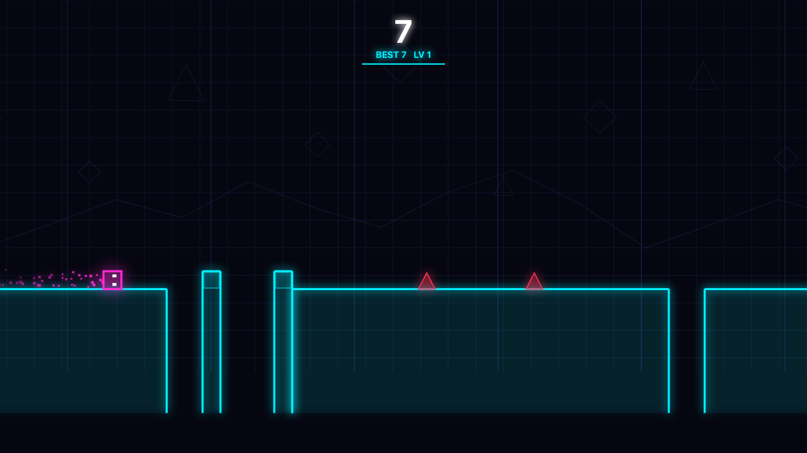
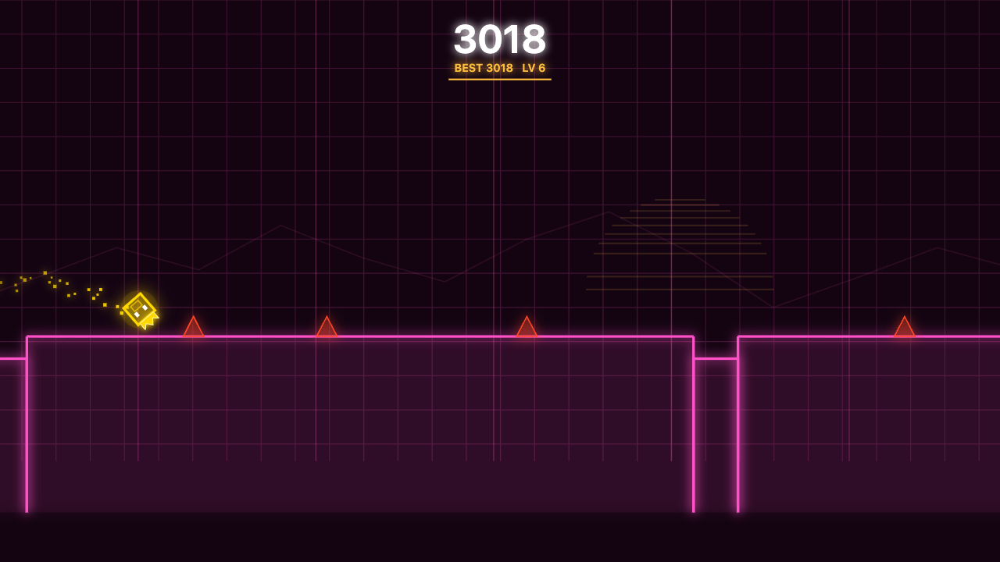
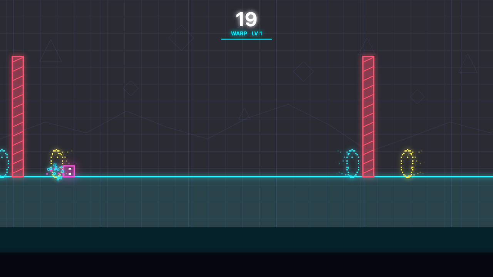
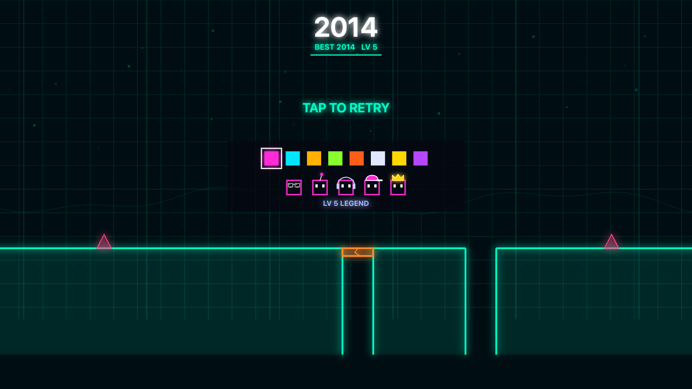

# Tumble

A neon side-scrolling runner. Your cube runs on its own; all you do is jump. Tap for a hop, hold for a higher jump. The cube turns a quarter with every jump and lands flat. Your score is how far you get, and your best is saved on your device.

**Play it here: https://lanny-macmillan.github.io/tumble/**



## The game

Each run climbs through seven levels. Every level is faster than the last and has its own colour zone and backdrop, and crossing into a new one sets off a burst of light and shake. The track is never the same twice: it is built on the fly from a set of hand-made pieces, and the deeper you go, the harder the pieces it is allowed to pick.

Along the way you will meet:

- **Spikes, gaps and platforms**, including moving platforms and tiles that crumble under you.
- **Tunnels** with low ceilings, where a short tap is all you have room for.
- **Boost pads** that push you to a higher speed for a while.
- **Jump orbs**, floating rings that throw the cube up as it passes through.
- **Slow-time and anti-gravity fields**: run through one and time halves, or every jump floats.
- **Warp portals** that carry you past a wall too tall to jump, and **flip portals** that turn the whole world upside down until the next one.
- **Blocks, stairs and bounce pads.**
- **Shields** that absorb one hit, the only way through laser gates and falling spike blocks.
- **Rage-bait traps**: floors that drop away, spikes that pop up, a roof that slams down. Each one gives a warning first.

Glowing gems mark the jump to make. Following them always gets you through.



### Cube levels and looks

Every metre you run counts toward your lifetime distance, and that raises your cube's own level from 1 (Rookie) to 5 (Legend). Each cube level unlocks new colours and something to wear: shades, an antenna, headphones, a cap, a crown. Pick them on the retry screen after a run. Higher cube levels also add an inner core and, at the top, a glowing aura.





## Controls

- **Jump:** tap, click, Space, Up arrow or W. Hold for a higher jump.
- **Restart:** tap or press Space after you die. On the retry screen, tap a colour or a wearable to put it on.
- **D:** debug overlay (frame rate, speed, current piece, deaths this session).

## Run it locally

There is nothing to install. Open `index.html` in a browser, or serve the folder:

```sh
python3 -m http.server 8000
```

and go to http://127.0.0.1:8000/.

### Test links

These runs never save a best.

- `?level=3` starts a normal run in level 3 (1 to 7).
- `?showcase=warp` plays one mechanic from its easiest form in level 1 up to level 7, at each level's speed. Names: `spikes`, `platforms`, `tunnel`, `boost`, `orbGap`, `slow`, `float`, `warp`, `flip`, `blocks`, `bounce`, `shield`, `vanish`, `popSpikes`, `slam`.
- `?practice=orbGap0,vanish2` repeats just those pieces. Piece names are in `L.CHUNKS` in `src/logic.js`.
- `?cubelevel=5` previews every look up to that cube level without saving anything.
- `?bench` runs a hands-free performance test and shows a table of frame times.

## How it works

Tumble is plain JavaScript and Canvas 2D: no framework, no build step, no dependencies. It is two files.

- `src/logic.js` is the game itself: physics, the track generator, collision, levels and save data. It has no DOM and no timers, so the same file runs in the page and in Node for the tests.
- `index.html` is everything you see and touch: input, the game loop, drawing, particles and screen shake.

Both load as classic scripts rather than ES modules, so the game also runs straight from `file://`. `logic.js` attaches itself to a global in the browser and to `module.exports` in Node.

### The loop

Each animation frame adds the elapsed time to an accumulator, and the simulation then advances in fixed steps of 1/120 s until the accumulator is used up. The picture is drawn once per frame. A fixed step keeps jumps the same height on every machine and frame rate, and lets the tests replay a run step by step and get exactly what a player would.

### Jumping

The cube's height comes from gravity rather than a fixed jump curve. While the button is held on the way up, gravity drops to about half, so a long hold carries the cube higher. Let go and gravity jumps to 1.7 times normal, cutting the jump short. On the way down it falls faster than it rose, which makes landings feel snappy. Two small allowances make it forgiving: you can still jump for 90 ms after running off a ledge, and a press up to 100 ms before landing is remembered and fires on touchdown.

Every size and speed is scaled from the cube's size, so changing that one number keeps the feel.

### Building the track

The track is a sequence of chunks, short hand-designed pieces (a gap, a tunnel, a warp wall and so on), each with an entry and exit height. A seeded random generator picks the next chunk from those allowed at the current distance and level: everything exists from the start in an easy form, and distance only raises the cap on how hard a piece may be. Chunks are placed about 70 tiles ahead of the cube and dropped once they are behind it, so the world uses the same small amount of memory however far you run.

Many mechanics are just geometry. A flip portal changes only how the world is drawn, since the physics never knows it is upside down. A vanishing floor is an ordinary gap that is drawn as solid ground until the trap fires.

### Making sure it is always fair

A runner that sometimes deals an impossible jump feels awful, so most of the test suite exists to rule that out.

- **Every chunk is cleared by a bot** at the speed of every level it can appear in. The bot searches for jumps by trying press times and hold lengths, and a jump only counts if it works across a window of start times about 67 ms wide. A jump that needs frame-perfect timing does not count.
- **No sequence of chunks is a dead end.** A chunk can be clearable on its own and still leave you somewhere the next chunk cannot be cleared from. The chain closure check (`test/closure/`) works this out for every chunk and every possible next chunk. It starts by assuming every position is safe, then repeatedly strikes out positions from which no fair jump leads to a safe one, until nothing changes. If any starting position survives for every pair, no order the generator picks can trap a careful player.
- **Long seeded runs** on many random worlds, with a bot that only looks as far ahead as the narrowest supported screen shows.
- **Unit tests** for physics, collision, every mechanic, levels and save data.

### Drawing

Everything is drawn with Canvas 2D paths and glow. Each level has its own palette and backdrop motif, which fade from one to the next when you level up. Behind the track, three parallax layers move at different fractions of the camera's speed and pulse with it. Particles are capped so a busy moment cannot slow the frame down.

### Saving

Your best distance, lifetime distance and chosen look are kept in `localStorage` as one small versioned record. Every read and write is wrapped so the game still works, with nothing saved, in a private window or when storage is blocked. A saved look is checked against your cube level when it is loaded, so an edited save cannot wear something that is still locked.

## Tests

The tests use Node's built-in test runner, so there is nothing to install (CI uses Node 24).

```sh
npm test             # the main suite, a few minutes
npm run test:full    # adds every level-speed pair and long bot runs
npm run test:chains  # the chain closure check (slow)
```

GitHub Actions runs `npm test` on every push and pull request, and each push to `main` that passes is published to GitHub Pages.

## What is next

- Sound: synth effects and music that speeds up with the game.
- Touch tuning and a play-through on phones.
- A home screen and settings.

## License

MIT. See [LICENSE](LICENSE).
